

# Essen

**Telegram Mini App for nutrition, training and AI coaching**

Log food by photo, voice or text · Train with a 3D exercise library · Talk to a coach that knows your data

 

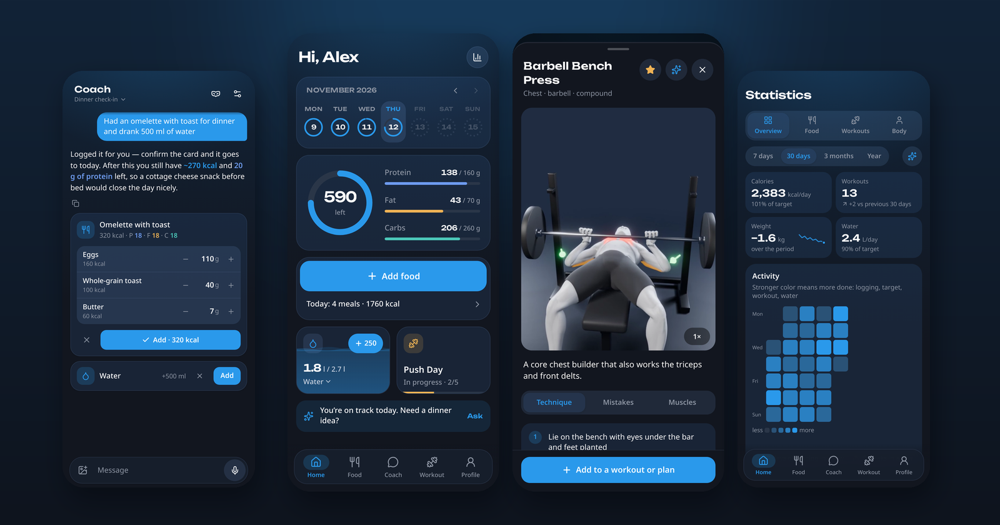

---

> [!NOTE]
> **This repository is a public snapshot from July 2026.** Essen is still in active development in a separate
> private repository, and the source code of newer versions is not published.
> This README and [`CHANGELOG.md`](CHANGELOG.md) describe the **current** app. The code here is the older
> snapshot and does not include the features below that were added after July 2026.

---

## About

Essen runs inside Telegram as a Mini App, so there is nothing to install. It brings together a food diary with
AI recognition, a workout journal, activity tracking, body metrics and an AI coach. The coach can take actions,
not just answer questions. Everything follows your Telegram account, theme and language.

---

## Screenshots

### Daily overview & food

<table>
  <tr>
    <td align="center">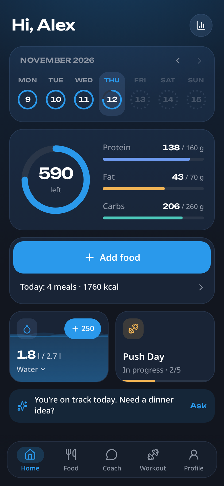 <b>Home</b>: calories left, macros, water, today's workout</td>
    <td align="center">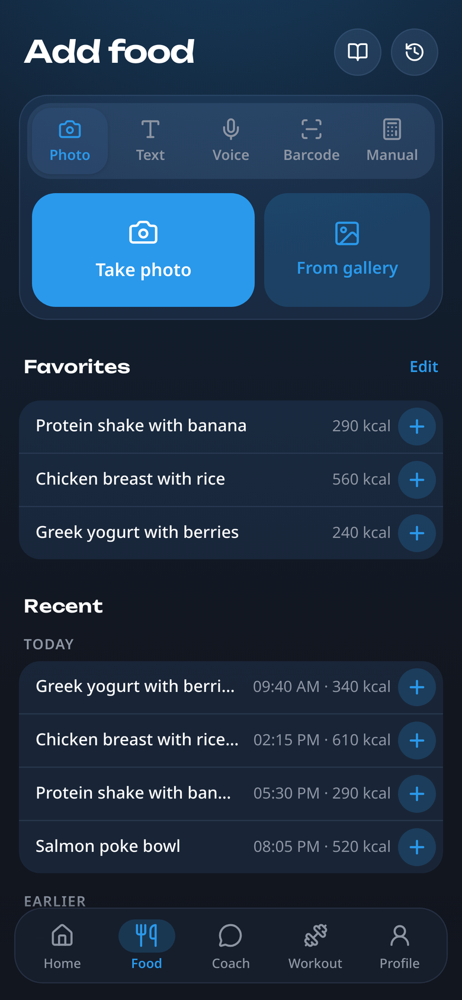 <b>Add food</b>: photo, text, voice, barcode or manual</td>
    <td align="center">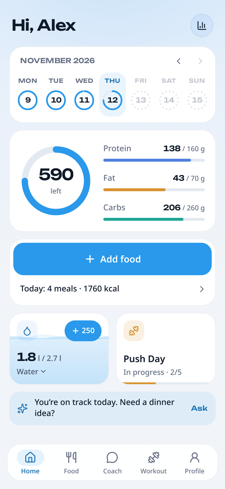 <b>Light theme</b>: follows Telegram or set by hand</td>
  </tr>
</table>

### AI coach

<table>
  <tr>
    <td align="center">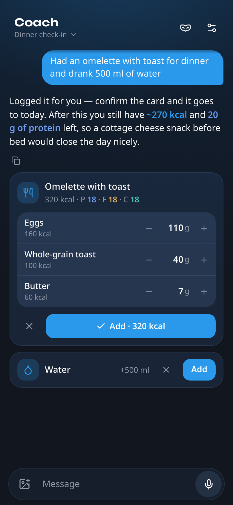 "I had…" becomes a meal card with editable ingredients</td>
    <td align="center">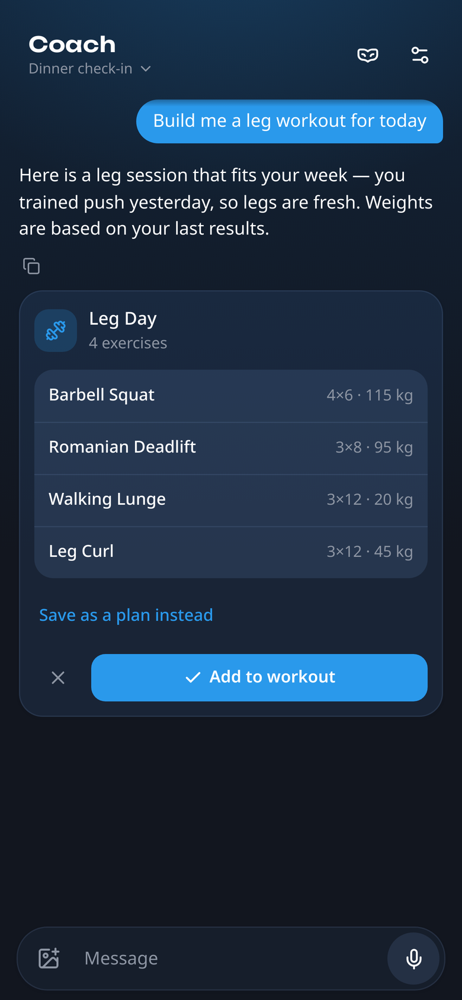 A workout for today, built from catalog exercises</td>
  </tr>
</table>

### Training

<table>
  <tr>
    <td align="center">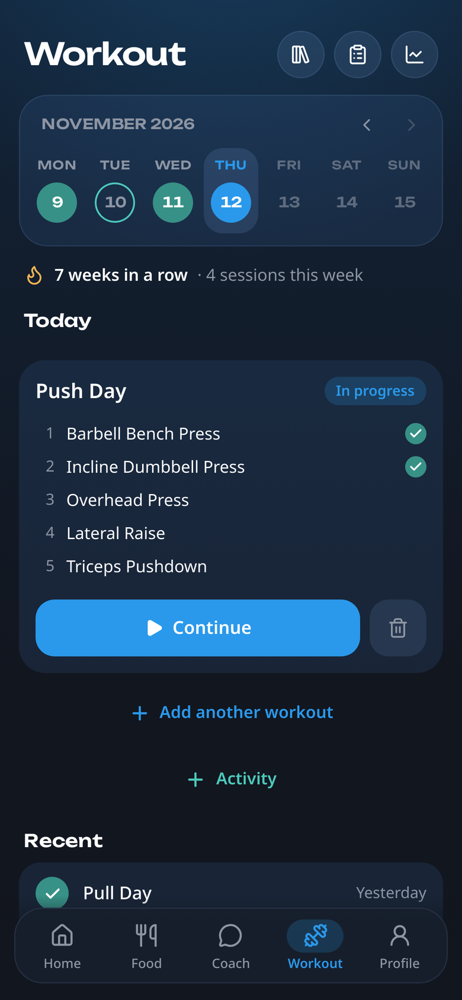 <b>Journal</b>: calendar, streak, today's session</td>
    <td align="center">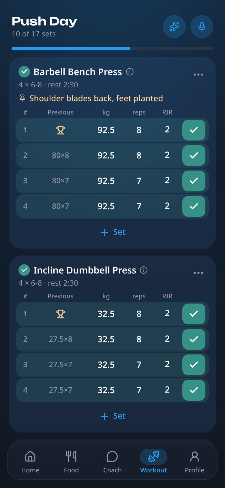 <b>Active workout</b>: previous results, records, rest timer</td>
    <td align="center">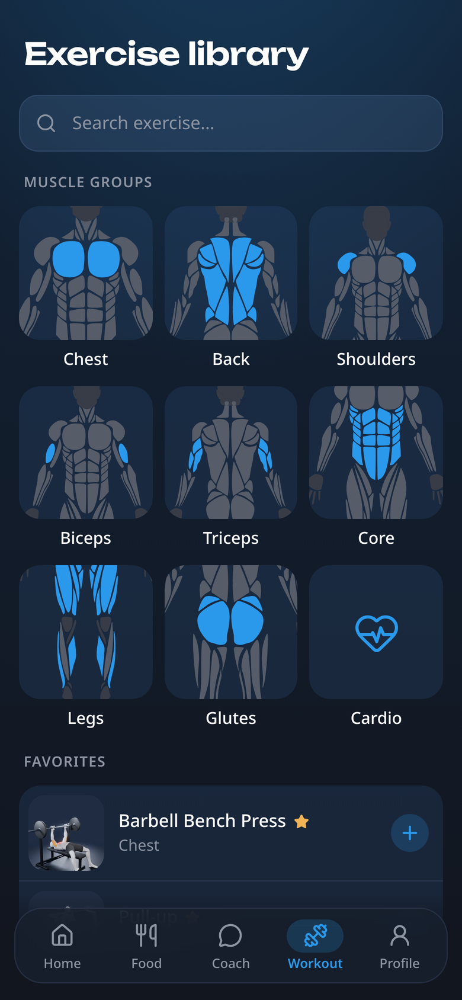 <b>Exercise library</b>: browse by muscle group</td>
  </tr>
  <tr>
    <td align="center">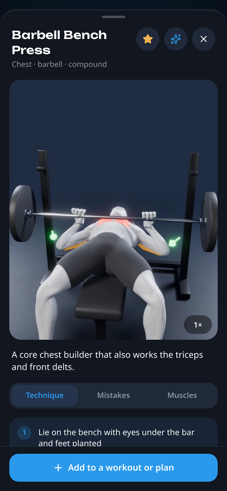 <b>Exercise card</b>: 3D technique clip, steps, mistakes, muscles</td>
    <td align="center">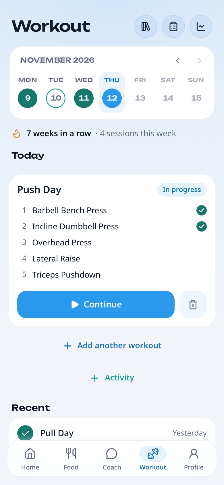 Workout journal, light theme</td>
    <td></td>
  </tr>
</table>

### Statistics

<table>
  <tr>
    <td align="center">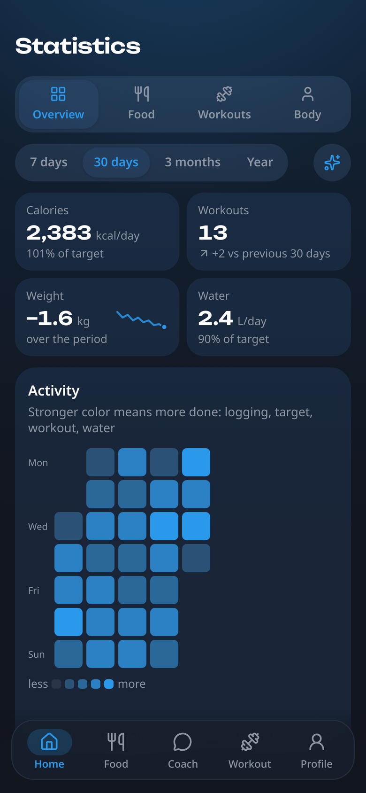 <b>Overview</b>: calories, workouts, weight, water, activity heatmap</td>
    <td align="center">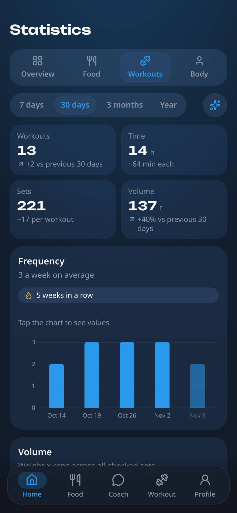 <b>Workouts</b>: frequency, time, sets, volume, records</td>
    <td align="center">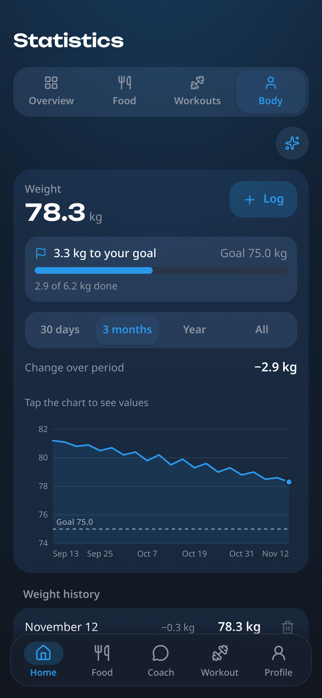 <b>Body</b>: weight trend toward your goal</td>
  </tr>
</table>

### Profile & personalization

<table>
  <tr>
    <td align="center">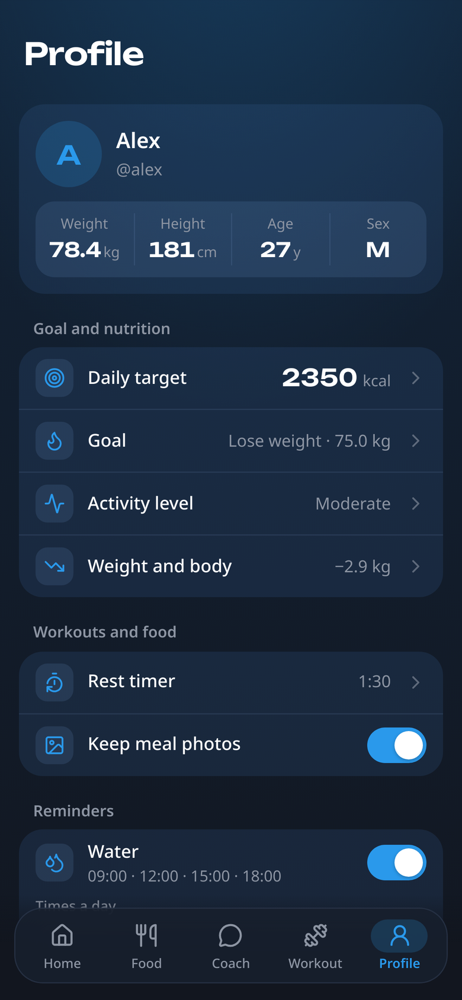 <b>Profile</b>: targets, goal, reminders, data</td>
    <td align="center">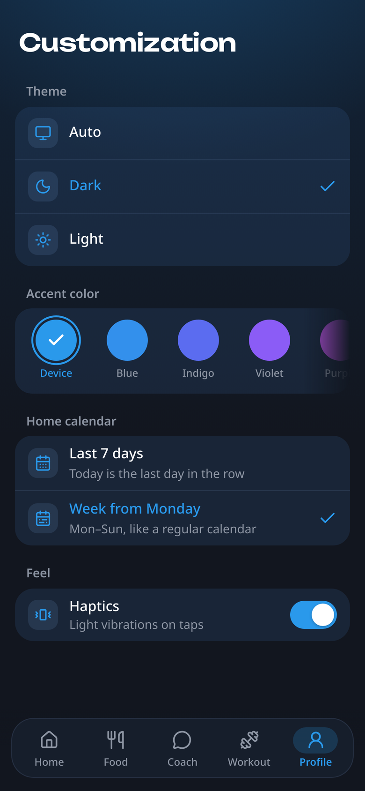 <b>Customization</b>: theme, accent color, calendar, haptics</td>
  </tr>
</table>

Screenshots use demo data.

---

## Features

### 🍏 Food tracking
- **Five ways to log**: photo (camera or gallery), free text, voice, barcode scan, or manual entry
- **AI recognition** splits a meal into ingredients with grams, calories and macros, and you can adjust any of them before saving
- **Favorites and recents**: add a usual meal again with one tap
- **Recipe library**: save your own recipes or have AI write one from a text or voice description
- **Meal history** grouped by day, with the original photos kept if you choose
- **Logging from the Telegram chat**: send the bot a text, photo or voice message and it logs the meal without opening the app

### 🤖 AI coach
- **Acts, not just answers**: "I had two eggs and toast", "drank 500 ml", "ran 40 minutes", "build me a leg day". Each one becomes a card you confirm with one tap (meal, water, activity, workout, recipe)
- **Knows your data**: today's targets and what is left, nutrition and weight trends, workout history, muscle load, your recipes
- **Workouts from the catalog**: proposed sessions use real catalog exercises with weights based on your last results, and can go straight into today's workout or be saved as a plan
- **Ask about this**: open the coach from a meal, an exercise or a statistics tab with that context attached
- **Multiple chats and notes**: separate conversations that are kept between sessions, plus notes the coach can suggest remembering

### 🏋️ Training
- **Exercise library**: 190+ catalog exercises organized by muscle group, with search, favorites and your own custom exercises
- **3D technique clips** for about 60 exercises, together with step-by-step technique, common mistakes and a muscle map
- **Plans and free workouts**: start from a plan, or start empty and save the session as a plan afterwards
- **Active workout**: previous results next to every set, personal records, pinned notes per exercise, and a rest timer you can adjust per exercise
- **Voice logging**: describe a finished workout and the app matches the exercises to the catalog
- **Muscle recommendations**: see which muscle groups are fresh and which were trained recently
- **Works offline**: sets logged in a gym with bad Wi-Fi are saved on the phone and synced later
- **Streaks and summaries**: weekly streak, workout summary and progression hints

### 🚶 Activity & body
- **Activity outside the gym** (running, cycling, walking, steps and more) adds to the day's calorie target
- **Weight tracking** with a goal weight and progress toward it
- **Body measurements**: waist, chest, hips, neck, arms and thighs, with their history

### 📊 Statistics
- **Overview, Food, Workouts and Body** tabs, each for 7 days, 30 days, 3 months or a year
- Calorie and macro adherence, meal timing, top meals, workout frequency, volume, personal records, weight trend
- **Activity heatmap** that combines logging, targets, workouts and water
- **Data export** to PDF, CSV, JSON or a plain-text report

### 🎨 Personalization
- **6 languages**: English, Ukrainian, Polish, Russian, Spanish, Brazilian Portuguese
- Separate settings for the **AI answer language** and the **dictation language**
- **Dark and light themes**, accent colors, a rolling or Monday-start week calendar, haptic feedback
- **Telegram full screen** with safe areas handled on phones, and the native Back button
- **Reminders** for water and meals that follow your own time zone

---

## Tech stack

| Layer | Technology |
|---|---|
| Client | React 19, TypeScript, Vite, Tailwind CSS 4, TanStack Query, i18next |
| Charts | Custom SVG charts |
| Backend | Serverless API on Vercel (Hono), Telegram bot (grammY) |
| Database | Supabase (PostgreSQL) |
| AI | OpenRouter (vision and text models), AssemblyAI (speech to text) |
| Platform | Telegram Mini Apps API |

---

## What's new

See [`CHANGELOG.md`](CHANGELOG.md) for everything that changed since this snapshot.

---

## About the code in this repository

The code here is the **July 2026 snapshot**. It is kept for reference and still runs as an earlier version of the app
(food tracking, workout plans, analytics). It does not include the AI coach, the exercise library, statistics v2,
activity tracking or the other features described above.

Running the snapshot

 

1. Requirements: Node.js 18+, a [Supabase](https://supabase.com) project, [OpenRouter](https://openrouter.ai) and [AssemblyAI](https://www.assemblyai.com) API keys.
2. Run `npm install`.
3. In the Supabase SQL editor, run `init_database.sql`. It creates all tables, indexes and RLS policies.
4. Copy `.env.example` to `.env` and fill in the keys. Each variable is documented in that file.
5. Run `npm run dev`. The app needs the Telegram WebApp context. In a plain browser it shows a "Telegram only" screen.
6. To deploy, connect the repository to Vercel, add the same variables in the Vercel dashboard, and point the bot webhook to `/api/webhook`.

---

## License

The snapshot code in this repository is licensed under the [MIT License](LICENSE).
